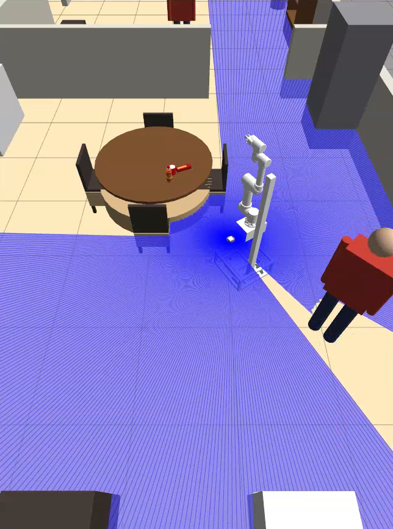
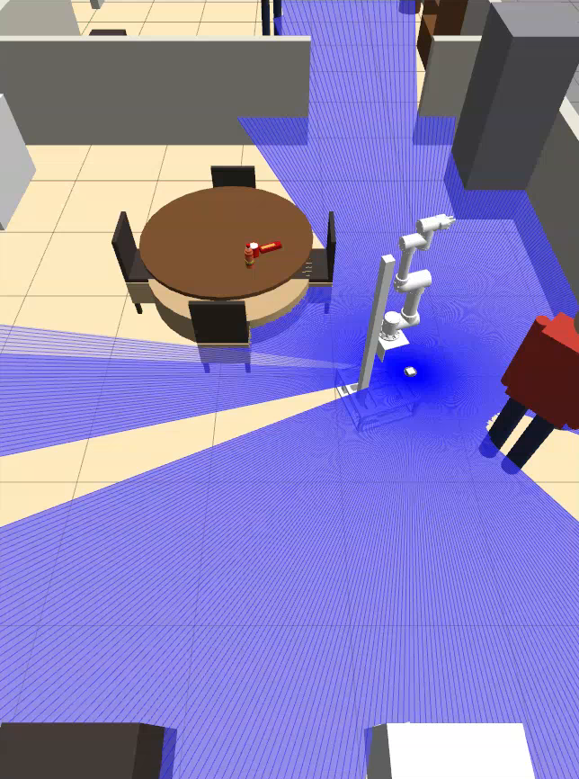
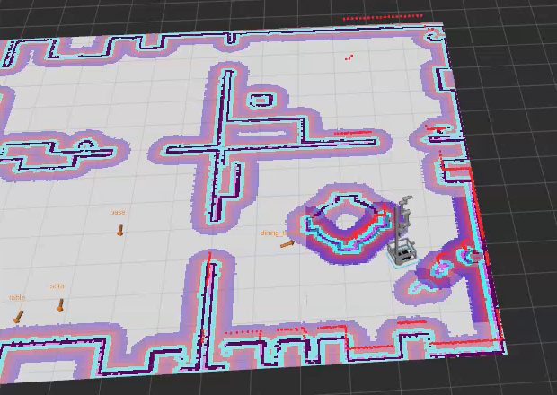
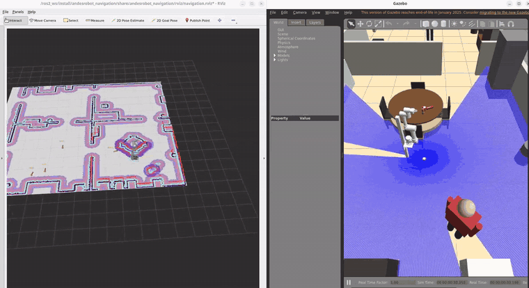

# milo_safety_rl

**Adaptive safety margins for a mobile manipulator, learned with PPO-Lagrangian and guarded by a certified shield.**
Code, trained policies and results for *Milo* (AndesRobot), a differential-drive base with a vertical lift, a 6-DoF arm and a 2D lidar. Simulation only.

<p align="center">
  
</p>

## The idea

The factory safety filter slows and stops the robot with a ramp between a stop distance (0.30 m) and a slow distance (0.70 m). That margin is too conservative to grasp: with the arm's reach, an object deeper than about 0.20 m inside a table cannot be reached. Relaxing the filter fixes that, but a filter that stays relaxed exposes the robot and nearby people for no reason.

We split the problem in two layers:

1. **A learned policy** (PPO-Lagrangian) decides, every 0.2 s, how much to relax the filter: the stop distances (front and sides), the width of the slow-down band, the maximum speed, and whether to lift the arm out of the lidar's way. It does not drive: a fixed executive plans and follows the route, and the filter only scales its velocity command.
2. **A certified shield** the policy cannot modify bounds whatever it learns: a braking-distance cap against furniture, the ISO/TS 15066 separation distance against people, a memory of what the arm hides from the lidar (its blind sector), and the footprint of the arm.

The policy is trained as a constrained MDP with two budgets, **exposure** (time moving with a relaxed filter) and **social comfort** (moving fast inside a person's personal space), enforced with dual ascent on the Lagrange multipliers.

The math and the file that implements each piece are in [`rl/METODO.md`](rl/METODO.md) (Spanish).

## Results

### Fast 2D simulator (1500 evaluation episodes per cell, same scenes for every method)

*Success* = the full grasp cycle is completed. *Exposure* is in seconds per episode (lower is better). *ISO viol.* = violations of the ISO/TS 15066 separation distance per episode, measured with true positions.

| Scenario | Method | Success | Exposure [s] | ISO viol. | Social cost |
|---|---|---|---|---|---|
| No people | Nominal filter | 0.253 | 0.00 | 0.000 | 0.00 |
| | Fixed minimum margins | 0.940 | 12.62 | 0.000 | 0.00 |
| | Rule-based | 0.927 | 0.79 | 0.000 | 0.00 |
| | **PPO-Lag + shield (ours)** | **0.980** | **0.25** | 0.000 | 0.00 |
| Static people | Nominal filter | 0.227 | 0.00 | 0.000 | 1.56 |
| | Fixed minimum margins | 0.693 | 11.08 | 0.000 | 1.97 |
| | Rule-based | 0.567 | 0.49 | 0.000 | 1.70 |
| | PPO without shield | 0.859 | 0.20 | 0.437 | 2.31 |
| | **PPO-Lag + shield (ours)** | 0.727 | **0.22** | 0.000 | 1.96 |
| Walking people | Nominal filter | 0.160 | 0.00 | 0.000 | 1.46 |
| | Fixed minimum margins | 0.563 | 9.54 | 0.000 | 1.74 |
| | Rule-based | 0.523 | 0.56 | 0.000 | 1.74 |
| | PPO without shield | 0.898 | 0.22 | **10.29** | 3.32 |
| | **PPO-Lag + shield (ours)** | 0.635 | **0.23** | 0.003 | 1.82 |

What this shows:

- Against the fixed filters, the learned policy reaches or beats the success of the loosest margins while being exposed **40 to 50 times less** than fixed minimum margins and about 2 to 3 times less than the rule-based baseline.
- **The shield is what keeps people safe.** The same policy without the shield is the most successful in the walking scenario, but it violates the separation distance 10 times per episode on average.
- The learned policy does **not** improve the social-comfort cost over the rule-based baseline (1.82 vs 1.74 walking, 1.96 vs 1.70 static). Its gain is in exposure and in task success, not in comfort.

### Ablations (walking people)

| Variant | Success | Exposure [s] | Comment |
|---|---|---|---|
| Full method | 0.635 | 0.23 | |
| No Lagrangian (fixed multipliers) | 0.627 | **1.78** | Exposure is 3.6x over its 0.5 budget: the dual ascent is what enforces the constraint |
| No shield | 0.898 | 0.22 | 10.29 ISO violations per episode |
| No blind-sector memory | 0.630 | 0.18 | No difference in normal scenes; see the stress test below |
| One stop distance instead of two sectors | 0.632 | 0.22 | No measurable difference |
| No people in the observation | 0.600 | 0.22 | Slightly lower success |
| Trained from scratch on the mixture (no curriculum) | 0.627 | 0.23 | Same as the curriculum |
| Specialist trained only on walking people | 0.594 | 0.26 | Not better than the generalist |

### Blind-sector stress test

A low box that is not on the planner's map is placed on the exit route, so only the shield can avoid it, including while the arm hides the lidar. Using a rule-based policy that relaxes the filter late, the shield never collided with the memory; with the memory disabled it collided in 3.3% of the episodes without people and 1.0% with people walking (300 episodes each). The success rate in this test is low for every method (it is not a success benchmark: the planner is blind to the obstacle by design).

### Validation in Gazebo (sim-to-sim)

The same filter, shield and policy run as a ROS 2 node in place of the real `safety_filter`, in Gazebo Classic 11 with a RoboCup@Home house, Nav2 and a map built in that house. Nav2 drives Milo to the pre-grasp pose of each object; then the node orients and approaches until the object is within reach of the arm. The arm is kept locked and the grasp itself is a 1 s stop, so what is measured is reaching the grasp position safely. Three people walk back and forth along routes that cross the way to three of the objects (`taza_comedor`, `botella_laundry`, `botella_librero`).

<p align="center">
  
  
</p>

<p align="center">
  
</p>

> Full run (RViz + Gazebo, 48 s): [`docs/media/run_walking_people.mp4`](docs/media/run_walking_people.mp4)

Each run visits 10 objects (bottles, mugs and cookie packs on tables and shelves), so there are 10 episodes per baseline and 50 for the policy (5 seeds). Only the episodes that go to the three objects above have a person crossing the approach:

| Method | Success | Exposure [s] | Time [s] | Social cost | Collisions | ISO viol. |
|---|---|---|---|---|---|---|
| Nominal filter | 0.00 | 0.00 | 90.5 | 2.47 | 0 | 0 |
| Fixed minimum margins | 0.80 | 10.69 | 55.7 | 1.86 | 0 | 0 |
| Rule-based | 0.90 | 1.04 | 48.6 | 1.72 | 0 | 0 |
| **PPO-Lag + shield (ours)** | **0.90** (0.8 to 1.0 across seeds) | **0.64** | **44.8** | **1.60** | 0 | 0 |

In Gazebo the policy matches the success of the rule-based baseline with about 40% less exposure and the shortest time, and uses 16 times less exposure than fixed minimum margins, with no collisions and no violations of the separation distance. With 10 episodes per baseline this is a consistency check of the 2D results, not a statistical comparison.

## Limitations

- **Simulation only.** No real-robot experiments.
- **People detection is simulated.** In Gazebo, a person is "seen" when a lidar point falls within 0.30 m of its true position, with Gaussian noise (5 cm) and dropped detections (5%). The lidar geometry is real; the person/not-person label is not. A learned detector is future work.
- **The grasp is simulated** (arm locked, 1 s stop once the object is within reach). The arm's reach, footprint and blind sector are modeled in the 2D simulator.
- **Social comfort is not improved** over the rule-based baseline.
- **People do not avoid the robot** in Gazebo; they follow their routes. The minimum distance to a person in Gazebo therefore reflects people walking into a stopped robot, and is not reported.
- The no-people and static-people Gazebo runs are not complete enough to report.

## Repository

```
rl/        2D simulator, filter + shield, PPO-Lagrangian, baselines, ablations, tests
           (LEEME.md: usage, METODO.md: math <-> code, LEEME_GAZEBO.md: Gazebo validation)
ros2_ws/   ROS 2 Humble + Gazebo Classic workspace of Milo (RoboCup@Home house, Nav2)
docker/    container image and compose files; sim.sh launches everything
results/   evaluation results used above (principal/, estres/, gazebo/)
docs/      media for this README
```

`rl/politicas/politica_s{0..4}.npz` are the five trained seeds exported to numpy (the Gazebo node runs them without PyTorch). `results/*/episodios.csv.gz` has one row per episode; the `resumen.csv` files are computed from it.

## Reproduce

2D simulator and training (pure Python, no ROS or Docker):

```bash
cd rl
pip install -r requirements.txt
python3 -m pytest -q tests                  # unit tests, including "the shield never collides"
python3 scripts/entrenar.py --prueba        # 20k-step smoke test of the 3-stage curriculum
bash scripts/lote.sh                        # full training and evaluation (see LEEME.md)
bash scripts/estres.sh                      # blind-sector stress test
```

Gazebo validation (needs Docker; see [`rl/LEEME_GAZEBO.md`](rl/LEEME_GAZEBO.md)):

```bash
./sim.sh casa && ./sim.sh teleop && ./sim.sh mapa casa_v2      # once: build the map of the house
./sim.sh rl casa_v2 ppo taza_comedor 1 robocup_casa_caminando 0   # one run with walking people
bash rl/scripts/gazebo_lote.sh casa_v2 robocup_casa_caminando  # all methods, 5 seeds (about 2 h)
python3 rl/scripts/gazebo_tabla.py ros2_ws/resultados/rl_*.csv    # summary table
```

## Notes

- Code comments, identifiers and the long-form docs under `rl/` are in Spanish; this README is the English entry point.
- `tools/poner_personas.py` needs `human_gazebo` and `humanos.py` (third party, not included). The generated world `robocup_casa_personas.world` is included and does not need them.
